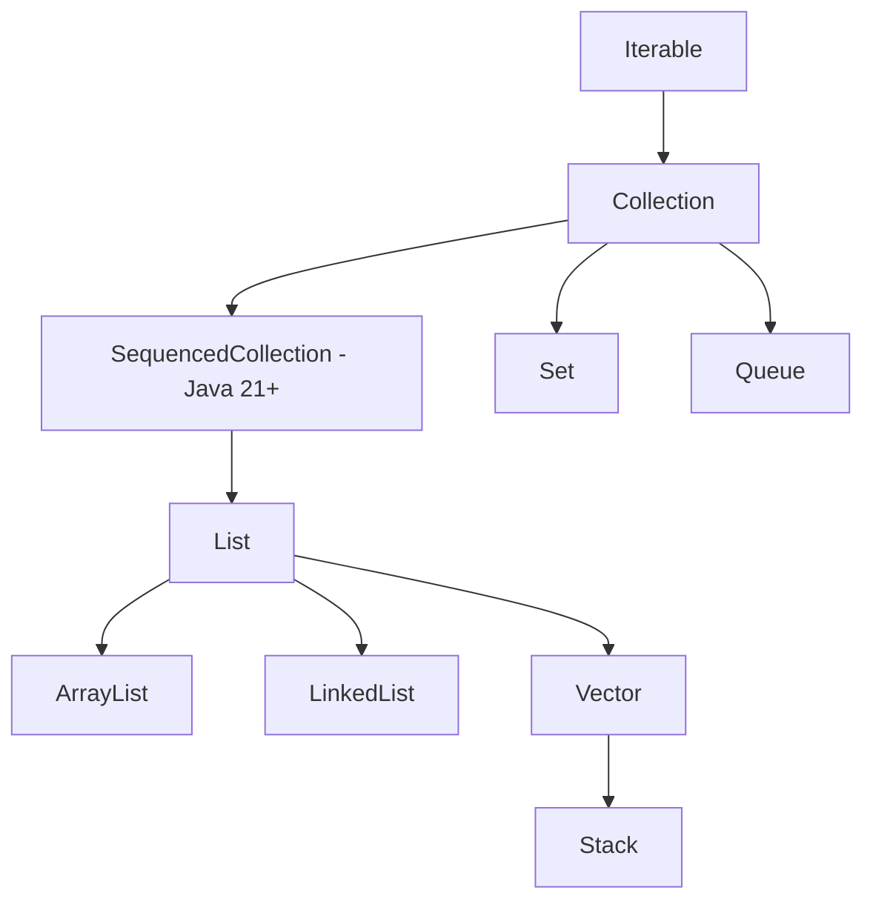

# The Java `List` Interface: A Deep, Step-by-Step Guide

> Goal: by the end of this note you should know what a `List` promises, how `ArrayList` and `LinkedList` actually work inside, and how to pick the right one without guessing.

---

## Table of Contents

1. [Where `List` fits in the family tree](#1-where-list-fits-in-the-family-tree)
2. [What makes a List a List](#2-what-makes-a-list-a-list)
3. [The essential methods, step by step](#3-the-essential-methods-step-by-step)
4. [The newer "sequenced" methods (Java 21)](#4-the-newer-sequenced-methods-java-21)
5. [ListIterator: walking in both directions](#5-listiterator-walking-in-both-directions)
6. [Immutable lists](#6-immutable-lists)
7. [Inside ArrayList](#7-inside-arraylist)
8. [Inside LinkedList](#8-inside-linkedlist)
9. [Legacy: Vector and Stack](#9-legacy-vector-and-stack)
10. [ArrayList vs LinkedList: choosing](#10-arraylist-vs-linkedlist-choosing)
11. [Common pitfalls](#11-common-pitfalls)
12. [Quick recap](#12-quick-recap)

---

## 1. Where `List` fits in the family tree

Every collection in Java descends from a few core interfaces. `List` sits a few levels down.



The same thing as plain text, in case your viewer doesn't render Mermaid:

```
Iterable
  └── Collection
        ├── SequencedCollection   (added in Java 21)
        │       └── List
        │             ├── ArrayList
        │             ├── LinkedList
        │             └── Vector
        │                   └── Stack
        ├── Set
        └── Queue
```

A few things worth noticing:

- `List` inherits everything from `Collection` (`add`, `remove`, `contains`, `size`, ...) and then adds list-specific powers on top.
- Before Java 21, `List` extended `Collection` directly. Java 21 slid a new interface, `SequencedCollection`, in between. It captures the idea of "a collection with a defined first element and last element", which is where `getFirst()` and `getLast()` come from.
- `List` is only the **contract** (the interface). `ArrayList`, `LinkedList` and friends are the **implementations** that do the real work.

---

## 2. What makes a List a List

Three properties define it:

| Property | Meaning |
|---|---|
| **Ordered** | Elements stay in the order you put them in (insertion order). |
| **Indexed** | Every element has a position `0, 1, 2, ...` and you can jump to it directly. |
| **Allows duplicates** | The same value can appear many times (unlike a `Set`). |

Most implementations also allow `null` elements (`ArrayList` and `LinkedList` do; `List.of(...)` does not).

```
Index:    0       1       2       3       4
        ┌───────┬───────┬───────┬───────┬───────┐
        │ "Ann" │ "Raj" │ "Ann" │ "Zoe" │ "Raj" │
        └───────┴───────┴───────┴───────┴───────┘
```

Notice `"Ann"` and `"Raj"` each appear twice, and that is perfectly legal.

A key idea to hold on to: **order here means "the order you inserted", not "sorted".** If you want sorted, you sort explicitly (`Collections.sort(list)` or `list.sort(null)`).

---

## 3. The essential methods, step by step

We'll build one list and change it step by step, so you can watch what each call does.

```java
List<String> fruits = new ArrayList<>();
```

### Step 1: `add(element)` appends to the end

```java
fruits.add("Apple");
fruits.add("Banana");
fruits.add("Cherry");
```

```
  0         1          2
┌─────────┬──────────┬──────────┐
│ Apple   │ Banana   │ Cherry   │
└─────────┴──────────┴──────────┘
```

### Step 2: `get(index)` reads by position

```java
String f = fruits.get(1);   // "Banana"
```

You say "give me position 1" and you get it. No searching. If the index is out of range you get an `IndexOutOfBoundsException`.

### Step 3: `set(index, element)` replaces, and does not shift anything

```java
fruits.set(1, "Blueberry");   // returns the OLD value: "Banana"
```

```
Before:  [ Apple | Banana    | Cherry ]
After:   [ Apple | Blueberry | Cherry ]
```

The size stays 3. `set` overwrites in place.

### Step 4: `add(index, element)` inserts and pushes everything after it to the right

```java
fruits.add(1, "Mango");
```

```
Before:  [ Apple | Blueberry | Cherry ]
                      │          │
                      ▼          ▼   (everything from index 1 moves right)
After:   [ Apple | Mango | Blueberry | Cherry ]
```

The size grows to 4. This shifting is exactly why inserting in the middle of an `ArrayList` costs more than appending (we'll see why in section 7).

### Step 5: `remove(index)` deletes by position and pulls everything after it to the left

```java
fruits.remove(0);   // removes "Apple", returns it
```

```
Before:  [ Apple | Mango | Blueberry | Cherry ]
After:   [ Mango | Blueberry | Cherry ]
```

### Step 6: searching, `indexOf`, `lastIndexOf`, `contains`

```java
fruits.indexOf("Cherry");      // 2
fruits.indexOf("Kiwi");        // -1  (not found)
fruits.contains("Mango");      // true
```

Under the hood these walk the list from the start and compare with `equals()`, so they are **O(n)**.

### Step 7: other handy ones

```java
fruits.size();                         // 3
fruits.isEmpty();                      // false
fruits.subList(0, 2);                  // view of positions 0 and 1 (end is exclusive)
fruits.sort(null);                     // natural ordering (alphabetical for Strings)
fruits.replaceAll(String::toUpperCase);// transform every element in place
fruits.removeIf(s -> s.startsWith("M"));// remove by condition
```

---

## 4. The newer "sequenced" methods (Java 21)

Before Java 21, getting the last element of a list was clumsy:

```java
String last = list.get(list.size() - 1);   // the old way
```

Java 21 gives `List` direct methods for both ends:

| Method | What it does |
|---|---|
| `getFirst()` | Returns the first element |
| `getLast()` | Returns the last element |
| `addFirst(e)` | Inserts at the front |
| `addLast(e)` | Inserts at the end |
| `removeFirst()` | Removes and returns the first element |
| `removeLast()` | Removes and returns the last element |
| `reversed()` | Returns a reverse-ordered **view** of the list |

```java
List<Integer> nums = new ArrayList<>(List.of(10, 20, 30));

nums.addFirst(5);        // [5, 10, 20, 30]
nums.addLast(40);        // [5, 10, 20, 30, 40]
nums.getFirst();         // 5
nums.getLast();          // 40
nums.removeFirst();      // [10, 20, 30, 40]
nums.reversed();         // [40, 30, 20, 10]  (a view, original is unchanged)
```

Good to know:

- On an **empty** list, `getFirst()`, `getLast()`, `removeFirst()` and `removeLast()` throw `NoSuchElementException`.
- On an **immutable** list, the modifying ones throw `UnsupportedOperationException`.
- These are defaults in the interface, so they work on `ArrayList`, `LinkedList` and others. Their speed still depends on the implementation (`addFirst` is O(1) on a `LinkedList` but O(n) on an `ArrayList`, because everything must shift right).

---

## 5. `ListIterator`: walking in both directions

A normal `Iterator` only moves forward. A `ListIterator` is the list's upgraded version:

- moves **forward and backward** (`next()` / `previous()`)
- tells you the current position (`nextIndex()` / `previousIndex()`)
- lets you **modify while iterating** (`add`, `set`, `remove`)

Think of it as a cursor that sits **between** elements, not on them:

```
        Apple     Mango     Cherry
      ↑         ↑         ↑         ↑
   index 0   index 1   index 2   index 3     ← cursor positions
```

```java
List<String> list = new ArrayList<>(List.of("Apple", "Mango", "Cherry"));
ListIterator<String> it = list.listIterator();

while (it.hasNext()) {
    String s = it.next();
    if (s.equals("Mango")) {
        it.set("Mango Pro");   // replace the element just returned by next()
        it.add("Kiwi");        // insert right after it
    }
}
// list = [Apple, Mango Pro, Kiwi, Cherry]

// now walk backwards
while (it.hasPrevious()) {
    System.out.println(it.previous());
}
```

Why this matters: modifying a list directly inside a normal for-each loop throws `ConcurrentModificationException`. Modifying **through the iterator itself** is the safe way. (`removeIf` is the even simpler option when you just want to delete by condition.)

---

## 6. Immutable lists

Sometimes you want a list nobody can change. Here are the options and how they differ:

| Way | Mutable? | Nulls? | Notes |
|---|---|---|---|
| `List.of("a", "b")` | No | **No** (throws `NullPointerException`) | Compact, truly immutable |
| `List.copyOf(other)` | No | No | Makes an immutable **copy** of an existing collection |
| `Collections.unmodifiableList(list)` | Can't change **through this wrapper** | Follows original | It is a **view**, so if someone changes the original, the view changes too |
| `Arrays.asList(arr)` | Can `set`, cannot `add`/`remove` | Yes | Fixed-size list backed by the array |

```java
List<String> a = List.of("x", "y");
a.add("z");                       // UnsupportedOperationException

List<String> original = new ArrayList<>(List.of("x", "y"));
List<String> view = Collections.unmodifiableList(original);
original.add("z");
System.out.println(view);         // [x, y, z]  <- the view saw the change!

List<String> copy = List.copyOf(original);
original.add("w");
System.out.println(copy);         // [x, y, z]  <- the copy is independent
```

Rule of thumb: use `List.copyOf` when you want a safe snapshot, and `List.of` for fixed constants.

---

## 7. Inside `ArrayList`

### The core idea

An `ArrayList` is a thin wrapper around a plain Java array that can grow. Two numbers matter:

- **size**: how many elements you have actually stored
- **capacity**: how many slots the internal array has

```
capacity = 10, size = 4

  0     1     2     3     4     5     6     7     8     9
┌─────┬─────┬─────┬─────┬─────┬─────┬─────┬─────┬─────┬─────┐
│  A  │  B  │  C  │  D  │     │     │     │     │     │     │
└─────┴─────┴─────┴─────┴─────┴─────┴─────┴─────┴─────┴─────┘
  ◄────── used ──────►   ◄──────── spare room ────────►
```

### How it grows (step by step)

1. `new ArrayList<>()` starts with an **empty** internal array (no memory reserved yet).
2. On the first `add`, it allocates room for **10** elements (the default capacity).
3. When the array is full and you add one more, it creates a **new bigger array** of about **1.5x** the old capacity: `newCapacity = oldCapacity + (oldCapacity >> 1)`.
4. It **copies** all existing elements into the new array and discards the old one.

```
capacity 10 ──full──► capacity 15 ──full──► capacity 22 ──full──► capacity 33 ...

   [ 10 slots ]        [ 15 slots ]           [ 22 slots ]
        │  copy all          │  copy all             │
        └──────────►         └──────────►            └────► ...
```

Copying is expensive, but it happens rarely, so the **average** cost of `add` at the end stays tiny. That is called **amortized O(1)**.

Tip: if you know roughly how many items you will add, tell it up front and skip the repeated copying:

```java
List<String> big = new ArrayList<>(10_000);
```

### Why `get(i)` is instant

The elements sit side by side in memory, so the JVM can calculate exactly where index `i` lives (start address + `i` × slot size). No walking required, which is **O(1)**. The same goes for `set(i, x)`.

### Why inserting or removing in the middle is slow

Elements must be physically moved to keep the array gap-free.

**Insert `X` at index 1:**

```
Start:    [ A | B | C | D | _ ]
Step 1:   shift D right   → [ A | B | C | _ | D ]
Step 2:   shift C right   → [ A | B | _ | C | D ]
Step 3:   shift B right   → [ A | _ | B | C | D ]
Step 4:   place X         → [ A | X | B | C | D ]
```

**Remove index 1:**

```
Start:    [ A | X | B | C | D ]
Step 1:   shift B left    → [ A | B | B | C | D ]
Step 2:   shift C left    → [ A | B | C | C | D ]
Step 3:   shift D left    → [ A | B | C | D | D ]
Step 4:   clear last slot → [ A | B | C | D | _ ]
```

In the worst case (insert/remove at the front) every element moves, so the cost is **O(n)**.

### ArrayList cost summary

| Operation | Cost |
|---|---|
| `get(i)`, `set(i, x)` | O(1) |
| `add(x)` at the end | amortized O(1) |
| `add(i, x)`, `remove(i)` in the middle/front | O(n) (shifting) |
| `contains(x)`, `indexOf(x)` | O(n) |

---

## 8. Inside `LinkedList`

### The core idea

A `LinkedList` is not an array at all. It is a chain of small objects called **nodes**. Each node holds a value plus two pointers: one to the **previous** node and one to the **next**. That makes it a **doubly linked list**. The list itself remembers just the `first` and `last` nodes.

```
        first                                              last
          │                                                  │
          ▼                                                  ▼
 null ◄─ [prev|"A"|next] ⇄ [prev|"B"|next] ⇄ [prev|"C"|next] ─► null
```

The nodes can be scattered anywhere in memory. The pointers are what hold the chain together.

### Why add/remove at the ends is fast

Because the list keeps direct references to both ends:

**`addFirst("Z")`:**

```
Before:   first → [A] ⇄ [B] ⇄ [C] ← last

Step 1: create a new node Z
Step 2: Z.next = A,  A.prev = Z
Step 3: first = Z

After:    first → [Z] ⇄ [A] ⇄ [B] ⇄ [C] ← last
```

Only a handful of pointers change, regardless of list size. That is **O(1)**. Same for `addLast`, `removeFirst`, `removeLast`.

### Why `get(i)` is slow, and the clever trick

There are no index calculations here. To reach position `i` you must **walk the chain**. But `LinkedList` is smart about it: it checks whether `i` is in the first half or the second half and starts from the **nearer end**.

```
size = 8, want index 6

Start from head?  6 hops  ✗
Start from tail?  1 hop   ✓  (since 6 > size/2, walk backward from last)

 first                                          last
   │                                              │
   ▼                                              ▼
  [0]⇄[1]⇄[2]⇄[3]⇄[4]⇄[5]⇄[6]⇄[7]
                              ▲
                         start here, walk back 1 step
```

Even with this trick, reaching the middle is still about n/2 hops, so `get(i)` is **O(n)**.

### What about inserting in the middle?

Two separate costs:

1. **Find the position:** O(n), walking the chain.
2. **Relink the pointers:** O(1).

So "insert in middle" is O(n) overall, the same big-O as `ArrayList`. The "LinkedList is great for middle inserts" claim only holds when you **already have a reference** to the node (for example through a `ListIterator` that is already positioned there).

### LinkedList extras

`LinkedList` implements both `List` and `Deque`, so it can also act as a queue or stack: `offer`, `poll`, `peek`, `push`, `pop`.

### LinkedList cost summary

| Operation | Cost |
|---|---|
| `addFirst`, `addLast`, `removeFirst`, `removeLast` | O(1) |
| `get(i)`, `set(i, x)` | O(n) |
| `add(i, x)`, `remove(i)` in the middle | O(n) to find, then O(1) to relink |
| `contains(x)` | O(n) |

Also remember: each node carries two extra pointers plus object overhead, so a `LinkedList` uses **more memory** than an `ArrayList` holding the same data.

---

## 9. Legacy: `Vector` and `Stack`

These come from Java's earliest days (before the Collections Framework):

- **`Vector`** is basically an `ArrayList` where every method is `synchronized`. That makes it thread-safe, but you pay a locking cost on every call, even when you only have one thread. It also grows by **doubling** by default, not 1.5x.
- **`Stack`** extends `Vector` and adds `push`, `pop`, `peek`. Because it inherits from `Vector`, it also exposes index-based methods that don't belong on a stack, which is a design flaw.

What to use instead:

| Old | Modern replacement |
|---|---|
| `Vector` | `ArrayList` (single thread) or `CopyOnWriteArrayList` / `Collections.synchronizedList` (multi-thread) |
| `Stack` | `ArrayDeque` used as a stack (`push` / `pop` / `peek`) |

---

## 10. `ArrayList` vs `LinkedList`: choosing

| Need | Better pick |
|---|---|
| Read by index often | **ArrayList** |
| Mostly append and iterate | **ArrayList** |
| Lots of add/remove at the **front** | LinkedList (or better, `ArrayDeque`) |
| Memory efficiency | **ArrayList** |
| Queue or deque behavior | `ArrayDeque` (usually) or `LinkedList` |

```
Default choice:  ArrayList
```

Why `ArrayList` wins most of the time, even where theory favors `LinkedList`:

- Its elements are **contiguous in memory**, which plays nicely with CPU caches. A `LinkedList` jumps around memory following pointers, which is much slower in practice.
- It stores less overhead per element.
- The "O(1) insert" of `LinkedList` only helps if you are already positioned at the spot.

So the video's takeaway is right: **start with `ArrayList` and switch only when you have a concrete, measured reason.**

---

## 11. Common pitfalls

### Pitfall 1: `remove(int)` vs `remove(Object)`

```java
List<Integer> nums = new ArrayList<>(List.of(10, 20, 30));

nums.remove(1);                    // removes at INDEX 1  → [10, 30]
nums.remove(Integer.valueOf(10));  // removes the VALUE 10 → [30]
```

With a `List<Integer>`, a bare `int` argument means "index". To remove by value, wrap it as `Integer`.

### Pitfall 2: modifying a list while looping over it

```java
for (String s : list) {
    if (s.equals("x")) list.remove(s);   // ConcurrentModificationException
}
```

Fix it with `list.removeIf(s -> s.equals("x"))` or an explicit `Iterator`/`ListIterator`.

### Pitfall 3: `subList` is a view, not a copy

```java
List<Integer> base = new ArrayList<>(List.of(1, 2, 3, 4, 5));
List<Integer> part = base.subList(1, 4);   // [2, 3, 4]
part.set(0, 99);
System.out.println(base);                  // [1, 99, 3, 4, 5]  <- original changed
```

If you want an independent copy, wrap it: `new ArrayList<>(base.subList(1, 4))`.

### Pitfall 4: `Arrays.asList` is fixed-size

```java
List<String> l = Arrays.asList("a", "b");
l.set(0, "z");    // fine
l.add("c");       // UnsupportedOperationException
```

### Pitfall 5: `List.of` rejects `null`

```java
List.of("a", null);   // NullPointerException
```

---

## 12. Quick recap

1. `List` = **ordered, indexed, duplicates allowed**. In Java 21+ it sits under `SequencedCollection`.
2. Core methods: `get`, `set`, `add(i, x)`, `remove(i)`, `indexOf`, `subList`, `sort`.
3. Java 21 added `getFirst`, `getLast`, `addFirst`, `addLast`, `removeFirst`, `removeLast`, `reversed`.
4. `ListIterator` goes both ways and can safely modify during iteration.
5. Immutable options: `List.of`, `List.copyOf` (true immutability), `unmodifiableList` (a view).
6. **ArrayList**: dynamic array, grows ~1.5x, O(1) access, O(n) middle insert/remove.
7. **LinkedList**: doubly linked nodes, O(1) at the ends, O(n) access, walks from the nearer end.
8. `Vector` and `Stack` are legacy; prefer `ArrayList` and `ArrayDeque`.
9. When in doubt: **use `ArrayList`.**
