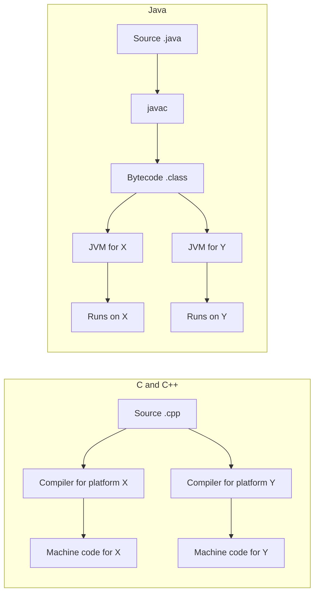

# Why Java Exists: Platform Independence, Bytecode, and the JVM

> Technical interview study notes. Built from the topics and questions collected in order, then researched against official documentation (links in section 16). Java details were checked against the Java SE 21 JVM Specification and JDK 26 (released 17 March 2026).

## Table of Contents

1. [Introduction and Big Picture](#1-introduction-and-big-picture)
2. [Prerequisites and Foundational Concepts](#2-prerequisites-and-foundational-concepts)
3. [Why C and C++ Programs Are Platform-Specific](#3-why-c-and-c-programs-are-platform-specific)
4. [Why Java Was Created: History and Design Goals](#4-why-java-was-created-history-and-design-goals)
5. [Pillar 1: Portability (Bytecode and the JVM)](#5-pillar-1-portability-bytecode-and-the-jvm)
6. [Pillar 2: Simplicity](#6-pillar-2-simplicity)
7. [Pillar 3: Security](#7-pillar-3-security)
8. [Applets, the Frontend, and the JavaScript Name](#8-applets-the-frontend-and-the-javascript-name)
9. [Microsoft, J++, and C#](#9-microsoft-j-and-c)
10. [Python and Other Platform-Independent Languages](#10-python-and-other-platform-independent-languages)
11. [Failure Modes and Common Mistakes](#11-failure-modes-and-common-mistakes)
12. [Common Misconceptions](#12-common-misconceptions)
13. [Technical Interview Preparation](#13-technical-interview-preparation)
14. [Technical Interview Questions](#14-technical-interview-questions)
15. [Quick Revision Notes](#15-quick-revision-notes)
16. [Glossary](#16-glossary)
17. [References and Further Reading](#17-references-and-further-reading)

---

## 1. Introduction and Big Picture

A program written in C or C++ is turned by a compiler into <u>machine code for one specific platform</u>, meaning one combination of processor and operating system. That compiled file is only meaningful to that kind of machine. To run the same program on a different kind of machine you have to compile it again with a compiler that targets the new machine, and often you also have to change parts of the source code.

For a long time that was acceptable, because software was built for a known machine and shipped on that machine. It became a serious problem when software had to run on many different kinds of devices, and later when software started to be delivered over networks to machines the author had never seen. Java was designed to remove that problem, and it did so with one central idea: <u>compile to an intermediate, architecture-neutral code (bytecode) and let a platform-specific program (the JVM) run it</u>.

The original Java design paper by Gosling and McGilton lists five design goals: simple, object-oriented and familiar; robust and secure; architecture-neutral and portable; high performance; and interpreted, threaded and dynamic. In the study notes below, three of these are treated as the main pillars:

| Pillar | The problem in C/C++ | Java's answer |
|---|---|---|
| Portability | Binaries are tied to one processor and OS | Bytecode plus a JVM for each platform |
| Simplicity | Manual memory, pointers, multiple inheritance, undefined behavior | Garbage collection, references instead of pointer arithmetic, single class inheritance plus interfaces |
| Security | Unchecked memory access allows buffer overflows and use-after-free | Bounds checks, type safety, bytecode verification, and (historically) a sandbox |



Two sentences that summarize the whole document: in C/C++ the platform-specific work (compiling) happens once per application per platform. In Java, the platform-specific work (the JVM) is done once per platform by a small number of JVM vendors, and every application benefits.

---

## 2. Prerequisites and Foundational Concepts

### 2.1 Machine code and the processor

A processor executes <u>instructions</u>, and each instruction is stored as a pattern of bits (ones and zeros). Inside the chip, billions of transistors act as switches that decode these bit patterns and carry out the operations they describe: add two numbers, load a value from memory, jump to another instruction.

A common first intuition is that programs differ between processors because the transistors or pins are arranged differently. That is partly true, but the precise statement matters in interviews:

<u>What fixes the meaning of the bit patterns is not the transistor layout itself but a published contract called the instruction set architecture (ISA).</u>

Two processors from different companies can have completely different internal designs and still understand exactly the same bit patterns, because they implement the same ISA. That is why most modern desktop and server processors from Intel and AMD, despite different internals, run the same x86-64 programs.

### 2.2 Instruction set architecture (ISA)

The ISA is the interface between hardware and software. It defines:

- which instructions exist (add, subtract, load, store, branch, call, return, and many more),
- how each instruction is encoded as bits,
- which registers exist and how large they are,
- how memory is addressed,
- how the processor behaves for each instruction (the semantics).

You can think of the ISA as the grammar and vocabulary of a processor family. Common ISAs include x86-64 (used by most Intel and AMD PCs and servers), ARM64 (also called AArch64, used by phones and by Apple silicon Macs), and RISC-V.

The following illustrative example shows the same operation, adding two 32-bit values, on two ISAs. The bytes are different because the ISAs are different. (Encodings shown for illustration; confirm them with an assembler or disassembler before relying on them.)

| ISA | Assembly | Encoded bytes (hex) |
|---|---|---|
| x86-64 | `add eax, ebx` | `01 D8` |
| ARM64 | `add w0, w0, w1` | `00 00 01 0B` |

A processor that implements x86-64 will not understand the ARM64 bytes, and the other way around. <u>This is the deepest reason a compiled C/C++ program cannot run on a different processor family.</u>

### 2.3 Operating system and its interface

Processors are not the only source of differences. A program does not run alone; it asks the operating system to do things for it, such as opening files, creating threads, allocating large blocks of memory, and talking to the network. Each operating system exposes these services differently:

- Different <u>system calls</u> and system libraries (the Windows API on Windows, POSIX-style interfaces on Linux and macOS).
- Different <u>executable file formats</u>: PE on Windows, ELF on Linux, Mach-O on macOS.
- Different <u>calling conventions</u> and binary interfaces (ABI), which determine how functions pass arguments and return values.

So the earlier observation that "the OS provides system libraries, so different operating systems cause different binaries" is correct, and it is a separate cause from the ISA.

### 2.4 What "platform" means

In these notes a <u>platform is the combination of processor architecture and operating system</u> (sometimes also including the ABI and standard libraries the program is built against). Examples:

- Intel/AMD x86-64 with Windows.
- Intel/AMD x86-64 with Linux.
- ARM64 with macOS.
- ARM64 with Android.

Changing either half gives a different platform.

### 2.5 Compiler, assembler, linker, loader

For a C or C++ program, building an executable usually goes through these stages:

1. Preprocessing (handling `#include`, `#define`, and conditional compilation such as `#ifdef`).
2. Compilation to assembly or object code for the target ISA.
3. Assembly to machine-code object files.
4. Linking with libraries (static libraries are copied in, dynamic libraries are located at load time) into an executable file in the OS's format.
5. At run time, the OS loader maps the executable into memory and starts it.

Steps 2 to 4 are all platform-specific, which is why "run the compiler again" is the only way to move a C/C++ program to a new platform.

### 2.6 Compiler, interpreter, and virtual machine

| Approach | What happens | Example |
|---|---|---|
| Ahead-of-time compiler to native code | Source becomes machine code before the program is delivered | C, C++ |
| Interpreter | A program reads source (or a simple internal form) and executes it step by step | classic scripting runtimes |
| Compile to bytecode, then run on a virtual machine | Source becomes portable intermediate code, and a virtual machine executes it, interpreting and/or compiling to native code at run time | Java, C#/.NET |

Java is in the third category. Importantly, the Java virtual machine also contains a compiler (the JIT, section 5.5), so Java is both compiled and interpreted depending on which stage you look at.

---

## 3. Why C and C++ Programs Are Platform-Specific

### 3.1 Two independent layers

Whether a compiled program runs on a machine depends on <u>two independent layers</u>: the ISA (the processor) and the OS interface (system calls, executable format, ABI).

| | Same OS | Different OS |
|---|---|---|
| Same ISA | The same binary can work | Different binary needed (for example Windows x86-64 versus Linux x86-64) |
| Different ISA | Different binary needed (for example Linux x86-64 versus Linux ARM64) | Different binary needed |

This table resolves a common confusion about whether it is the system libraries or the ISA that matters. Both matter, independently, and a change in either one forces a different build.

Operating systems and vendors sometimes bundle several builds in one file to hide this from the user. For example, Apple's universal (fat) binaries carry code for more than one ISA inside one file. That is a convenience for distribution, not a removal of the problem: the program was still compiled separately for each ISA. (General knowledge, not separately sourced here.)

### 3.2 The same source can behave differently

Even when you recompile, the source code might not mean the same thing on every platform. A classic example:

```cpp
#include <iostream>

int main() {
    std::cout << sizeof(long) << '\n';
}
```

On typical 64-bit Linux and macOS builds this prints `8`, while on typical 64-bit Windows builds with MSVC it prints `4`. The language only guarantees minimum sizes for its integer types, so the size is chosen by the implementation. A program that silently depends on `long` being 64 bits can break after being moved.

A second source of difference is direct use of OS APIs:

```cpp
// Not portable: needs a different branch for each OS.
#ifdef _WIN32
  #include <windows.h>
  void pause_one_second() { Sleep(1000); }          // milliseconds
#else
  #include <unistd.h>
  void pause_one_second() { sleep(1); }             // seconds
#endif
```

```cpp
// Portable: the standard library hides the OS difference.
#include <chrono>
#include <thread>

void pause_one_second() {
    std::this_thread::sleep_for(std::chrono::seconds(1));
}
```

The portable version works because the standard library, written separately for each platform by the compiler or library vendor, hides the difference. <u>Portability always comes from an abstraction layer written once per platform</u>, and this pattern appears again with Java's JVM and class library.

### 3.3 Is C/C++ really "not portable"? A necessary refinement

It is common to hear that C and C++ are "not portable languages". That statement is too strong, and an interviewer may challenge it.

<u>The compiled binary is platform-specific. The source code can be portable.</u> Standard C++ programs that avoid platform-specific APIs and avoid relying on implementation-specific behavior can be compiled for many platforms, and many large projects do this.

The difficulty is that the C++ standard deliberately leaves many behaviors open. The standard describes three families of such behavior:

- <u>Implementation-defined behavior</u>: varies between implementations, and each implementation must document what it does.
- <u>Unspecified behavior</u>: varies between implementations, and the implementation does not have to document it.
- <u>Undefined behavior (UB)</u>: the standard places no restrictions at all on what happens. Examples include out-of-bounds array access, signed integer overflow, and null pointer dereference.

These exist so compilers can generate fast code on very different hardware. The price is that a program relying on them may work on one platform and fail on another. So it is more accurate to say: <u>C and C++ give you source-level portability with effort, but never binary portability, and the developer carries the burden of staying within the portable subset.</u>

An example of UB-driven surprise:

```cpp
// Signed overflow is undefined behavior in C++.
bool always_true(int x) {
    return x + 1 > x;   // an optimizing compiler is allowed to compile this as "return true"
}
```

For `x == INT_MAX` a naive reading says the result is `false` because the addition wraps around, but since overflow is undefined, the compiler may assume it never happens. Different compilers, versions, and optimization levels can therefore behave differently.

Java removes most of these open choices. For example, `int` is always 32 bits, and the Java white paper states that the language specification contains no implementation-dependent behavior notes.

### 3.4 Why was C++ not simply changed to run everywhere?

It is a natural question: if the problem was known, why not change C++ the way Java was designed? The following reasons come from the language's goals and history, and the last point is analysis rather than a cited fact.

1. <u>Different purpose.</u> C was created for system programming and C++ was built on top of it with the goal of keeping low-level control and hardware-level efficiency. Pointers, manual memory control, and types sized to the machine are features for that purpose, not accidents.
2. <u>Compatibility with C and existing code.</u> C++ was designed to work with C code and C libraries. Changing the meaning of types, removing pointers, or adding a mandatory runtime would break that.
3. <u>Cost model.</u> A mandatory virtual machine with garbage collection and verification adds runtime cost and indirection. That conflicts with C++ use cases such as operating-system kernels, device drivers, embedded software, and performance-critical engines.
4. <u>Portability was achieved a different way.</u> C++ chose portability of the source through standardization, plus a separate compiler for each target, instead of portability of the binary through a virtual machine.
5. <u>Timing and installed base (analysis).</u> By the time Java appeared in the mid 1990s, C and C++ already had a very large body of existing code and tools. A change of the scale needed would have created a different language anyway, which is effectively what Java is: familiar C-like syntax with different semantics.

C++ can in some cases be compiled for a virtual machine target, for example C++/CLI for the .NET runtime, or toolchains that target WebAssembly, but these are restricted or special-purpose arrangements and not the normal way C++ is used. (General knowledge, not separately sourced here; verify before relying on exact details.)

### 3.5 Is it still true today?

Yes, for compiled output. A binary built for Windows x86-64 will not run on Linux ARM64. What has changed is the tooling around the problem:

- Compilers can cross-compile (build for a platform other than the one they run on).
- Build systems and continuous-integration pipelines produce a binary for each target automatically.
- Universal binaries and multi-architecture container images package several builds together.
- Package managers distribute prebuilt binaries per platform.

These reduce the pain but they do not remove the need for a separate build per platform. The problem has become cheaper, not different.

### 3.6 A hypothetical scenario: shipping one program to three platforms

This scenario is hypothetical and is meant to show the cost model.

A small company writes a desktop tool in C++ in the mid 1990s and wants to sell it to customers who use Windows PCs, Macs, and several Unix workstation types. For each platform it needs:

- a compiler and build environment for that platform,
- source changes wherever the code touches OS-specific features,
- a separate test machine and test cycle,
- a separate installer and a separate support path for bugs that appear only on one platform.

If the company has `M` products and `N` platforms, the work grows like `M × N`. That multiplication is the economic reason platform dependence was a serious problem, and the reason a new approach was attractive: if the platform-specific work could be done once per platform by someone else, the growth becomes `M + N`.

---
